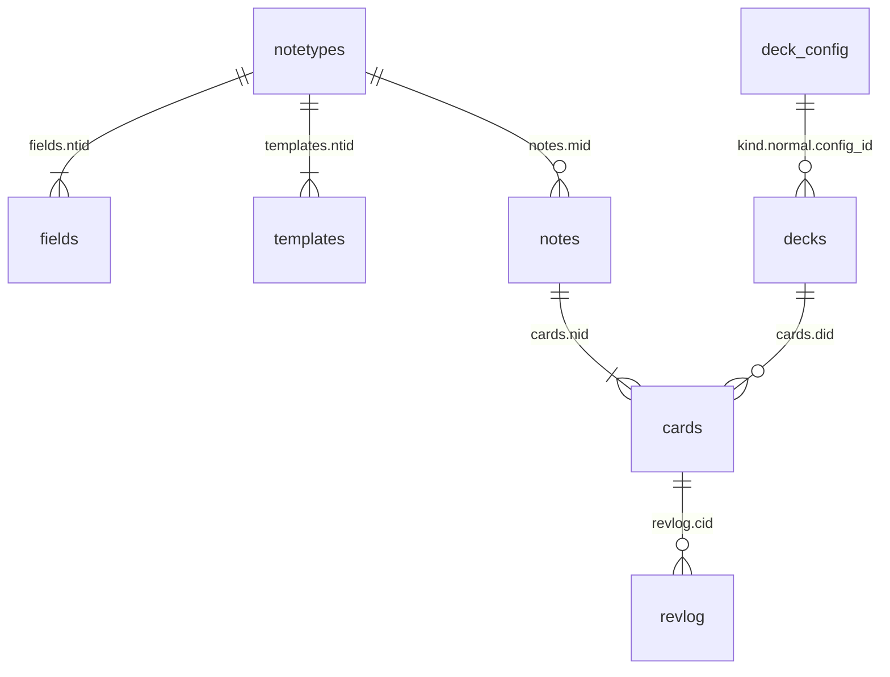

# Collection schema v18

The Anki collection is a single SQLite database. The DDL is in `src/genanki2/_schema.py`, dumped from a collection the official client created. Everything here was read from Anki's Rust source (`rslib/`) and from a freshly created collection.

## Quick guide

12 tables in 4 groups:

**Types.** `notetypes` plus its `fields` and `templates` define the shape of a note: how many fields, what they are called, and the HTML templates that turns them into cards. A note points at a notetype by `mid`, and its field values are stored positionally, so field order is part of the contract.

**Content.** `notes` holds the data necessary to produce a card using a notetype. One note produces one card per template whose condition its fields satisfy, so a two-way vocabulary note (i.e. a notetype with 2 templates) produces two cards from one row of text.
`cards` holds what you review and carry all the scheduling state.

**Organisation.** A deck is a group of cards. `decks`, although a flat table, fakes a tree through `::` in the name. `deck_config` holds scheduling presets, which decks reference by id, so many decks can share one preset.
`config` is a collection-wide key/value store.
`tags` is a registry of known tags, separate from the tags actually written on each note.

**History and sync.** `revlog` is an append-only log of answers and references `cards`.
`graves` records deletions so a sync can replay them.
`col` is a single row of collection metadata.

Three special things:

- **No foreign keys.** `cards.nid`, `notes.mid`, `cards.did` and the rest are plain integers. SQLite enforces nothing; Anki maintains referential integrity in application code and repairs it in Check Database. A row pointing at a missing parent is writable and will be dealt with on import, not rejected.
- **Config columns are serialized blobs.** `decks.common`, `decks.kind`, `notetypes.config`, `fields.config`, `templates.config` and `deck_config.config` hold protobuf messages defined in `anki/proto/anki/`. This is what makes the schema opaque to plain SQL and is the reason any collection writer needs the generated protobuf modules to write anything beyond a stock notetype. `config.val` is the exception because it is JSON, not protobuf (reference: `rslib/src/storage/config/mod.rs`).
- **Two id conventions.** Row ids for `notes`, `cards` and `revlog` are the current time in milliseconds. When a row already holds that id, the insert uses `max(id) + 1` instead, so adding many notes within one millisecond gives consecutive ids rather than a failure (`rslib/src/storage/note/add.sql`). Ids for `decks`, `notetypes` and `deck_config` are also timestamps at creation, but are treated as opaque stable identifiers afterwards: they are what an `.apkg` matches on when re-importing, so changing one forks the deck or notetype instead of updating it. Nothing enforces either convention; both are just what Anki happens to write.

The remaining four tables join to nothing, so they are left out of the diagram:

| Table | Key | Holds | Why it stands alone |
|---|---|---|---|
| `col` | `id`, always `1` | Collection metadata: schema version, creation time, sync state. | A singleton. Everything else in the collection is implicitly "the" collection's. |
| `config` | `key` | Collection-wide settings, one row per setting. | Keys are opaque strings, not references. |
| `tags` | `tag` | The set of tags that exist, with their sidebar state. | A registry mirroring what is written in `notes.tags`; no row points at a note. |
| `graves` | `(oid, type)` | Tombstones for deleted cards, notes and decks. | `oid` names a row that was deleted, which says nothing about whether the id is in use now. |

## unicase collation

Six columns are declared `COLLATE unicase`: the `name` of decks, presets, notetypes, fields and templates, and `tags.tag`. The collation is Anki's own, registered from Rust, and stdlib `sqlite3` refuses DDL that names a collation it does not know, so genanki2 registers one under the same name before running the DDL. The file stores only the name, and Anki resolves it against its own implementation when it opens the file.

The comparator has to order strings as Anki's does: SQLite orders index entries physically by it, and a disagreement makes Anki's lookups through those indexes miss rows. `str.casefold` agrees with Anki's `unicase` 2.6.0 on every pair of the corpus in `tests/test_unicase_matches_anki.py`, while `str.lower` splits `ß` from `ss` and final sigma from medial sigma. Anki pins the crate to that exact version for the same reason, so a change of the pin is the signal to run the test again. `COLLATE NOCASE` is no substitute, since it folds ASCII only and breaks every non-ASCII deck name and tag.

## col

One row, `id = 1`, holding collection-wide metadata.

| Column | Type | Role |
|---|---|---|
| `id` | integer | Always `1`. |
| `crt` | integer | Creation time, seconds. Rounded back to the day's rollover hour (4am local by default), so it is a day boundary, not the exact moment of creation. Review cards count their `due` in days from this instant, which makes it the epoch of the whole scheduler. |
| `mod` | integer | Last modification, milliseconds. |
| `scm` | integer | Schema modification time, milliseconds. A client whose `scm` differs from the server's must do a full sync rather than an incremental one. |
| `ver` | integer | Schema version, `18`. |
| `dty` | integer | Dirty flag, unused in practice, `0`. |
| `usn` | integer | Update sequence number for the collection, `0` in a fresh collection. |
| `ls` | integer | Last sync time, milliseconds, `0` if never synced. |
| `conf` | text | Legacy v11 global config JSON. Emptied by the upgrade to v18, now `''`. |
| `models` | text | Legacy v11 notetype JSON. Now `''`. |
| `decks` | text | Legacy v11 deck JSON. Now `''`. |
| `dconf` | text | Legacy v11 deck config JSON. Now `''`. |
| `tags` | text | Legacy v11 tag JSON. Now `''`. |

The five legacy text columns are the visible seam between v11 and v18: the upgrade moved their contents into the normalized tables and blanked them, but did not drop the columns. They are `NOT NULL`, so a writer must supply `''`.

No indexes beyond the primary key.

## notes

The text of a note, plus derived values that support search and duplicate detection.

| Column | Type | Role |
|---|---|---|
| `id` | integer | Millisecond timestamp, primary key. |
| `guid` | text | Random base91 string, ten characters. Identity across collections: the importer matches an incoming note to an existing one by `guid`, never by `id`. |
| `mid` | integer | Notetype id. Determines how `flds` is interpreted. |
| `mod` | integer | Last modification, seconds. |
| `usn` | integer | Update sequence number, `-1` until synced. |
| `tags` | text | Space separated, with a leading and trailing space when non-empty (` vocab verb `), and exactly `''` when empty (`rslib/src/tags/mod.rs:46`). The padding is what makes `tags LIKE '% vocab %'` a correct whole-tag search. |
| `flds` | text | All field values joined by `\x1f` (unit separator). Positional: field 0 is the notetype's field with `ord = 0`. |
| `sfld` | integer | The sort field's value, HTML stripped. Which field that is comes from the notetype's `sort_field_idx`. Declared `integer` deliberately so that numeric content sorts numerically under SQLite's type affinity, while text content stays text. |
| `csum` | integer | First four bytes of the SHA-1 of the HTML-stripped first field, big-endian (`rslib/src/notes/mod.rs:320`). Only a duplicate-detection prefilter, never an identity. |
| `flags` | integer | Unused, `0`. |
| `data` | text | Unused, `''`. |

- `idx_notes_mid` on `(mid)`: find every note of a notetype, needed whenever a notetype changes.
- `ix_notes_csum` on `(csum)`: the duplicate check, which narrows by checksum and then compares the actual field.
- `ix_notes_usn` on `(usn)`: collect notes pending sync.

`sfld` and `csum` are both derived from `flds`. A writer that sets them inconsistently produces a collection that works but sorts or deduplicates wrongly, and nothing reports it.

## cards

One row per card. Every scheduling decision lives here.

| Column | Type | Role |
|---|---|---|
| `id` | integer | Millisecond timestamp, primary key. |
| `nid` | integer | Note id. |
| `did` | integer | Deck id. |
| `ord` | integer | Which template produced this card, matching `templates.ord`. For cloze notetypes it is the cloze number minus one instead. |
| `mod` | integer | Last modification, seconds. |
| `usn` | integer | Update sequence number, `-1` until synced. |
| `type` | integer | `0` new, `1` learning, `2` review, `3` relearning (`rslib/src/card/mod.rs:39`). |
| `queue` | integer | Where the scheduler will look for it: `0` new, `1` learning, `2` review, `3` day learning, `4` preview repeat, `-1` suspended, `-2` buried by the scheduler, `-3` buried by the user. |
| `due` | integer | Meaning depends on `queue`: a position in the new queue for `0`, a Unix timestamp in seconds for `1` and `4`, days since `col.crt` for `2` and `3`. |
| `ivl` | integer | Current interval in days. `0` for a new card. |
| `factor` | integer | Ease factor in permille, `2500` meaning 250%. `0` for a new card. |
| `reps` | integer | Number of times answered. |
| `lapses` | integer | Number of times a review card was failed. |
| `left` | integer | Learning steps remaining, encoded as `steps_today * 1000 + steps_total`. `0` outside learning. |
| `odue` | integer | The `due` value to restore when the card leaves a filtered deck. `0` otherwise. |
| `odid` | integer | The deck to return to when the card leaves a filtered deck. `0` otherwise. |
| `flags` | integer | User-visible colour flag, low bits of a u8. `0` for none. |
| `data` | text | JSON object of optional extras: `pos` (original new-queue position), `s` / `d` / `dr` (FSRS stability, difficulty, desired retention), `decay`, `lrt` (last review time), `cd` (custom scheduling data). Every key is omitted when unset, so a fresh card is `'{}'`, not `''` (`rslib/src/storage/card/data.rs`). |

- `ix_cards_sched` on `(did, queue, due)`: the scheduler's main query, "what is next in this deck".
- `ix_cards_nid` on `(nid)`: find a note's cards, needed on every note edit.
- `idx_cards_odid` on `(odid) WHERE odid != 0`: partial index, so it only covers cards currently in a filtered deck.
- `ix_cards_usn` on `(usn)`: collect cards pending sync.

A new, never-studied card is `type = 0, queue = 0, ivl = 0, factor = 0, reps = 0, lapses = 0, left = 0, odue = 0, odid = 0, flags = 0, data = '{}'`, with `due` set to the next position from the `nextPos` config key.

## notetypes

| Column | Type | Role |
|---|---|---|
| `id` | integer | Primary key, a timestamp at creation, stable thereafter. |
| `name` | text | `COLLATE unicase`, unique. |
| `mtime_secs` | integer | Last modification, seconds. |
| `usn` | integer | Update sequence number, sync marker. |
| `config` | blob | `NotetypeConfig` protobuf: CSS, LaTeX preamble and postamble, `sort_field_idx`, kind (normal or cloze), and the per-template field requirements Anki uses to decide which cards a note generates. |

- `idx_notetypes_name` unique on `(name)`: notetype names are an enforced unique key, unlike deck names being unique only by the same kind of index.
- `idx_notetypes_usn` on `(usn)`.

A fresh collection ships six: Basic, Basic (and reversed card), Basic (optional reversed card), Basic (type in the answer), Cloze, Image Occlusion.

## fields

| Column | Type | Role |
|---|---|---|
| `ntid` | integer | Notetype id, half of the primary key. |
| `ord` | integer | Position, from `0`. The index into `notes.flds`. |
| `name` | text | `COLLATE unicase`. The name templates reference as `{{Front}}`. |
| `config` | blob | `FieldConfig` protobuf: font, size, right-to-left, sticky, plain text, collapsed, excluded from search. |

`WITHOUT ROWID`, primary key `(ntid, ord)`.

- `idx_fields_name_ntid` unique on `(name, ntid)`: field names are unique within a notetype, which is what lets a template reference a field by name.

## templates

| Column | Type | Role |
|---|---|---|
| `ntid` | integer | Notetype id, half of the primary key. |
| `ord` | integer | Position, from `0`. Matches `cards.ord`. |
| `name` | text | `COLLATE unicase`. Shown as the card type name. |
| `mtime_secs` | integer | Last modification, seconds. |
| `usn` | integer | Update sequence number, sync marker. |
| `config` | blob | `CardTemplateConfig` protobuf: `q_format` and `a_format` (the question and answer HTML), their browser variants, target deck override, browser font (`anki/proto/anki/notetypes.proto:104`). |

`WITHOUT ROWID`, primary key `(ntid, ord)`.

- `idx_templates_name_ntid` unique on `(name, ntid)`.
- `idx_templates_usn` on `(usn)`.

The card HTML being inside a protobuf blob is the single most consequential fact in this schema for a writer: no custom card template can be produced by manipulating plain columns.

## decks

| Column | Type | Role |
|---|---|---|
| `id` | integer | Primary key. `1` is always the Default deck. |
| `name` | text | `COLLATE unicase`, unique. Hierarchy is encoded in the name with `::`, so `Italian::Verbs` is a child of `Italian`. The parent must exist as its own row. |
| `mtime_secs` | integer | Last modification, seconds. |
| `usn` | integer | Update sequence number, sync marker. |
| `common` | blob | `DeckCommon` protobuf: study counts, collapsed state, last studied, description flags. |
| `kind` | blob | `DeckKind` protobuf, a oneof. Normal decks carry the `deck_config` id they use plus per-deck limit overrides and the description; filtered decks carry search terms, order and reschedule settings instead. |

- `idx_decks_name` unique on `(name)`, under `unicase`, so `Italian` and `italian` collide.

The hierarchy being string-encoded means a subdeck costs nothing structurally: write both rows, name the child with `::`, and Anki renders the tree.

## deck_config

| Column | Type | Role |
|---|---|---|
| `id` | integer | Primary key. `1` is always the Default preset. |
| `name` | text | `COLLATE unicase`. |
| `mtime_secs` | integer | Last modification, seconds. |
| `usn` | integer | Update sequence number, sync marker. |
| `config` | blob | `DeckConfigInner` protobuf: learning and relearning steps, new and review daily limits, starting ease, interval modifiers, leech threshold and action, burying options, FSRS parameters. |

No indexes beyond the primary key. Presets are few and looked up by id.

## config

Collection-wide key/value settings.

| Column | Type | Role |
|---|---|---|
| `key` | text | Primary key. |
| `usn` | integer | Update sequence number, sync marker. |
| `mtime_secs` | integer | Last modification, seconds. |
| `val` | blob | **JSON**, not protobuf (`rslib/src/storage/config/mod.rs`, `serde_json::from_slice`). A boolean is the three bytes `true`, a string is quoted, so `sortType` is stored as `"noteFld"` with the quotes. |

`WITHOUT ROWID`. No secondary indexes.

A fresh collection has 18 keys, including `curDeck`, `curModel`, `nextPos` (the next new-card position to hand out), `schedVer`, `sched2021`, `creationOffset` (minutes of UTC offset at creation, which pairs with `col.crt` to reconstruct the local day boundary), and two bookkeeping keys of the form `_deck_<id>_lastNotetype` and `_nt_<id>_lastDeck`.

## tags

A registry of tags that exist, distinct from the tags recorded on notes.

| Column | Type | Role |
|---|---|---|
| `tag` | text | Primary key, `COLLATE unicase`. `::` marks hierarchy, as with decks. |
| `usn` | integer | Update sequence number, sync marker. |
| `collapsed` | boolean | Whether the sidebar shows it collapsed. |
| `config` | blob | Nullable, the only nullable column in the schema. |

`WITHOUT ROWID`. No secondary indexes.

The authoritative tags for a note are in `notes.tags`; this table exists so the browser sidebar can list and collapse tags without scanning every note. A fresh collection has zero rows.

An apkg export never writes this table, and an import rebuilds the registry from the notes it adds, so the collapsed state survives only in a colpkg. The export also strips `marked` and `leech` from every note, case-insensitively, so a note's tags can differ between a collection and a package exported from it, while the registry may still hold both.

## revlog

Append-only log of answers, one row per button press. Drives the statistics screens and trains FSRS.

| Column | Type | Role |
|---|---|---|
| `id` | integer | Millisecond timestamp of the review, primary key. |
| `cid` | integer | Card id. |
| `usn` | integer | Update sequence number, sync marker. |
| `ease` | integer | Button pressed, `1` to `4`. `0` means a manual reschedule. |
| `ivl` | integer | New interval. Positive is days, negative is seconds. |
| `lastIvl` | integer | Previous interval, same sign convention. |
| `factor` | integer | Ease after answering, permille. Under FSRS this holds normalized difficulty in the 100 to 1100 range instead. |
| `time` | integer | Milliseconds spent answering. |
| `type` | integer | `0` learning, `1` review, `2` relearning, `3` filtered, `4` manual, `5` rescheduled (`rslib/src/revlog/mod.rs:65`). |

- `ix_revlog_cid` on `(cid)`: a card's history.
- `ix_revlog_usn` on `(usn)`.

An apkg carries the revlog only when exported with scheduling, and an import reads it only with `with_scheduling` on. An imported entry has its `cid` rewritten to the id its card was given, and one whose id the target already holds is dropped rather than renumbered. Deleting a card does not delete its reviews, so a row whose `cid` names no card is an ordinary state of a real collection.

## graves

Deletion tombstones, so a sync can tell "deleted here" from "not yet created here".

| Column | Type | Role |
|---|---|---|
| `oid` | integer | The deleted row's id, half of the primary key. |
| `type` | integer | `0` card, `1` note, `2` deck (`rslib/src/storage/graves/mod.rs:15`). |
| `usn` | integer | Update sequence number. `-1` while the deletion is still pending upload. |

`WITHOUT ROWID`, primary key `(oid, type)`.

- `idx_graves_pending` on `(usn)`: find the pending tombstones without scanning.

Cleared after a full sync. A newly written collection has none.

Only sync reads this table. An apkg export never writes it, so a colpkg is the only package that carries graves. A grave's `oid` often names a row the collection currently holds, which is what a deck deleted and imported again under the same ids leaves behind: in a measured real collection, 5705 of 6163 card graves and 3073 of 3364 note graves did.

## sqlite_stat1 and sqlite_stat4

These appear in a dumped collection but are not Anki's. They are SQLite's query planner statistics, produced by `ANALYZE`, which Anki runs as part of `vacuum; reindex; analyze` when the schema is marked modified (`rslib/src/storage/sqlite.rs:643`). SQLite creates and populates them itself; a writer should leave them out and let the client generate them.

## What varies between two fresh collections

Creating an empty collection twice does not give the same bytes. Everything that moves, measured by diffing three empty collections cell by cell (two created moments apart, one under a different timezone):

| Where | Example | What it is |
|---|---|---|
| `col.crt` | `1785895200` | Day zero of the scheduler. Changes with the creation date and with the timezone. |
| `col.scm` | `1785934748825` | Schema modification time, milliseconds. |
| `config` row `creationOffset`, `val` | `-120` | UTC offset in minutes at creation. Changes with the timezone, not with time. |
| `config` row `curModel`, `val` | `1785934748830` | The Basic notetype's id, as a bare JSON number. Follows the notetype ids below. |
| `config` row `curModel`, `mtime_secs` | `1785934748` | Seconds timestamp. The only `config` row a fresh collection leaves with a non-zero `usn` or `mtime_secs`. |
| `notetypes.id`, and `fields.ntid` / `templates.ntid` referencing it | `1785934748830` through `...835` | The six stock notetype ids: millisecond timestamps, allocated consecutively as the notetypes are added. |
| `fields.config` blob, field 9 | trailing `48 <varint>` | The field's stable id, `rand::random()` (`rslib/src/notetype/fields.rs:41`). |
| `templates.config` blob, field 8 | trailing `40 <varint>` | The template's stable id, `rand::random()` (`rslib/src/notetype/templates.rs:96`). |

The two random ids exist for merging notetypes on import (Anki 23.10 and later), so they identify a field or template across installations rather than describing its content. They are full-range `int64` and negative about half the time, which is why an otherwise identical `fields.config` blob is 19 bytes in one collection and 20 in the next: a negative value costs a 10-byte varint.

Everything else is stable: `notetypes.config` (it carries `original_stock_kind`, not an id), all of `deck_config`, all of `decks`, `col.mod` at `0`, every remaining `config` row at `usn = 0, mtime_secs = 0`, and the five legacy text columns in `col` at `''`.

Row order is stable without an `ORDER BY`. The rowid tables scan in rowid order, and the `WITHOUT ROWID` tables scan in primary key order, which is `(ntid, ord)` for `fields` and `templates` and the key string for `config`.
